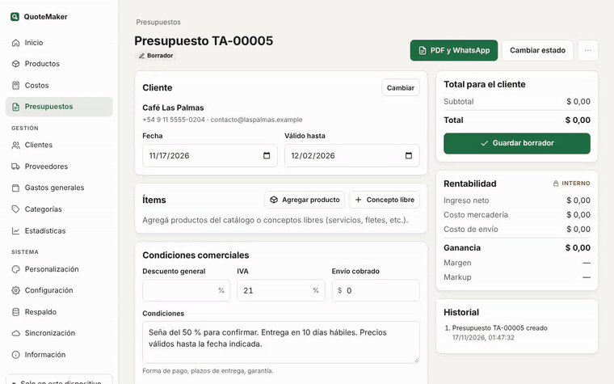

<p align="center"></p>

<p align="center"><strong>Real costs, healthy prices and professional quotes — without ever exposing your internal costs.</strong></p>

[Versión en español](README.md)

QuoteMaker is a **private** management tool for small businesses that sell products. Record purchases and related expenses (travel, fuel, tolls, shipping, packaging…); QuoteMaker computes the **real unit cost** of each product, suggests a **price for your target margin**, and produces **PDF quotes and WhatsApp messages** that never include internal data. The app UI is in Spanish.



## Highlights

- Decimal-safe money math (big.js), margin vs markup, break-even, percentage and fixed charges, commercial rounding, scenarios.
- Expense allocation by units, value, weight, volume, percentage or amount, with preview and exact rounding residuals; no double counting.
- Lot-based real unit cost with immutable history; overheads with optional per-unit allocation.
- Private customers; quotes with manual statuses, frozen snapshot when sent, duplicate, event history.
- **Privacy by construction**: PDF and WhatsApp generators only accept an allowlisted `PublicQuoteDocument`; automated tests extract PDF text, metadata and decompressed streams and fail on any internal value.
- Offline-first (IndexedDB), installable PWA, Android app (Capacitor) with native share sheet.
- Optional sync with **Supabase Free**: Row Level Security, idempotent pushes, optimistic versioning, explicit conflict resolution.
- WCAG 2.2 AA automated checks (axe) on every screen, desktop and mobile; light/dark/custom themes with enforced contrast.

## Quick start

```bash
npm ci
npm run build && npm run preview   # http://localhost:4173 — use "Probar con datos de ejemplo" for fictitious demo data
npm test && npm run test:integration && npm run test:e2e
```

Android APK: download the `quotemaker-apk` artifact from the [CI workflow](https://github.com/kkshiiit/QuoteMaker/actions/workflows/ci.yml), or build with `npx cap sync android && cd android && ./gradlew assembleDebug` (JDK 21 + Android SDK).

## Known limitations

- Cloud sync was verified against a **real PostgreSQL 16** (migration, RLS with two users, sync engine with two devices), **not against a live Supabase project** (no credentials available).
- Android is built with Capacitor (system WebView), not Kotlin/Compose — see `docs/ARCHITECTURE.md`.
- Automated browser tests run on Chromium only.

Docs (Spanish): [User guide](docs/USER_GUIDE.md) · [Installation](docs/INSTALLATION.md) · [Architecture](docs/ARCHITECTURE.md) · [Database](docs/DATABASE.md) · [Security](docs/SECURITY.md) · [Performance](docs/PERFORMANCE.md) · [Accessibility](docs/ACCESSIBILITY.md) · [Zero cost](docs/ZERO-COST.md) · [Roadmap](docs/ROADMAP.md).

License: MIT.
