<p align="center">
  
</p>

<p align="center"><strong>Costos reales, precios con margen sano, ventas en el local y online, productos para compartir en redes y presupuestos profesionales — sin exponer jamás tus costos.</strong></p>

<p align="center">
  <a href="https://github.com/kkshiiit/QuoteMaker/actions/workflows/ci.yml"></a>
  · Web (PWA) · Android (APK) · Offline-first · Licencia MIT · Costo $0
</p>

[English version](README.en.md)

**Chediek Home** (antes QuoteMaker) es una herramienta **privada** para tu negocio. Registrás compras y gastos (viajes, combustible, peajes, envíos, embalaje…), la app calcula el **costo unitario real** de cada producto, te sugiere un **precio con el margen que buscás** y arma **presupuestos en PDF y mensajes de WhatsApp** que nunca incluyen información interna.

> Los clientes no tienen cuentas ni acceso: son contactos privados tuyos. Nada se envía ni cambia de estado sin tu intervención.

**Novedades 1.1:** historial de **ventas** (en el local y online, por cliente), **compartir productos** con fotos, videos y links a Instagram, Facebook y TikTok, diseño **Spatial** con temas claro/oscuro, paletas clásicas y **(+) Pasteles** con vista previa. Ver [CHANGELOG](CHANGELOG.md).

- **Web:** https://kkshiiit.github.io/QuoteMaker/ (instalable como app, funciona sin conexión)
- **Android:** APK en [Releases](https://github.com/kkshiiit/QuoteMaker/releases)

| Inicio | Presupuesto | Documento para el cliente |
|---|---|---|
| 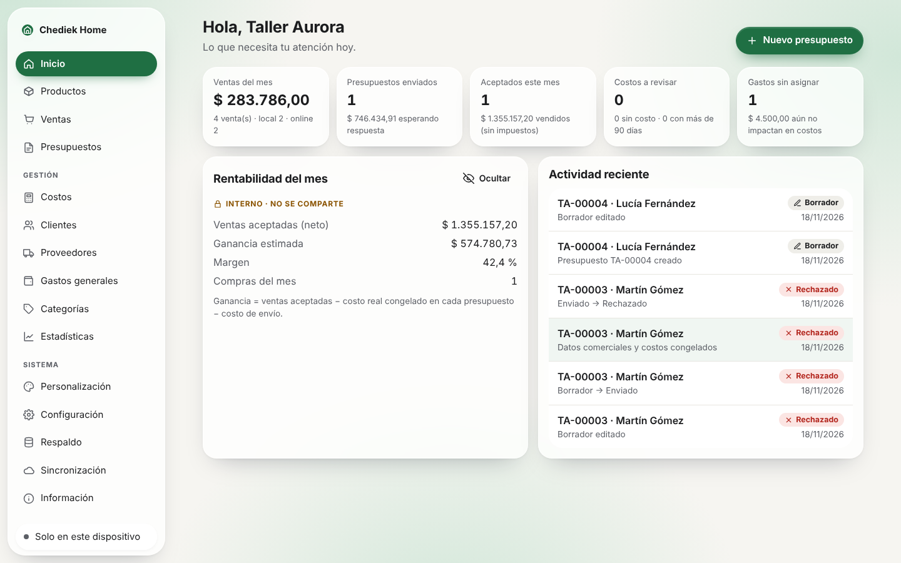 | 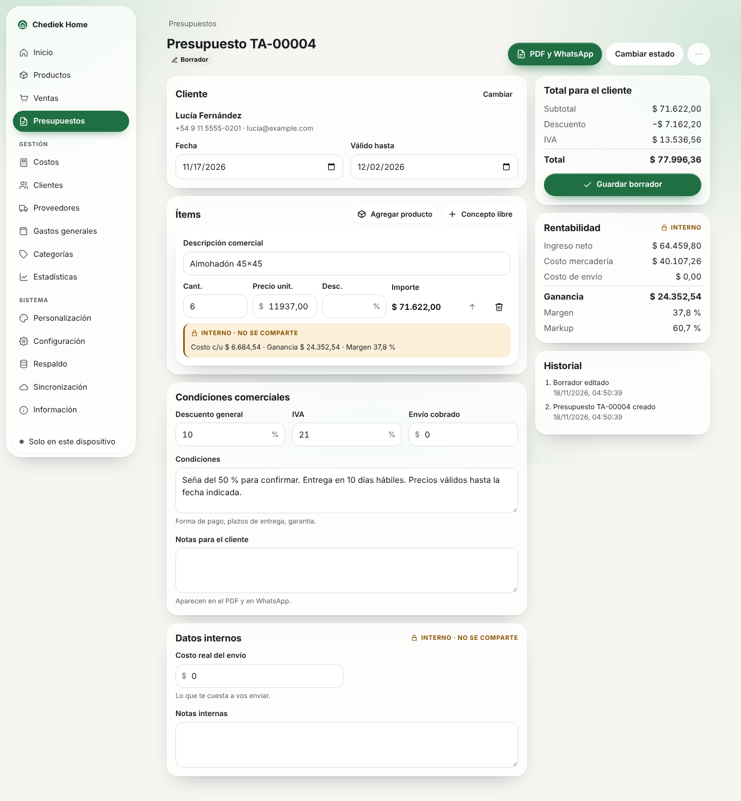 | 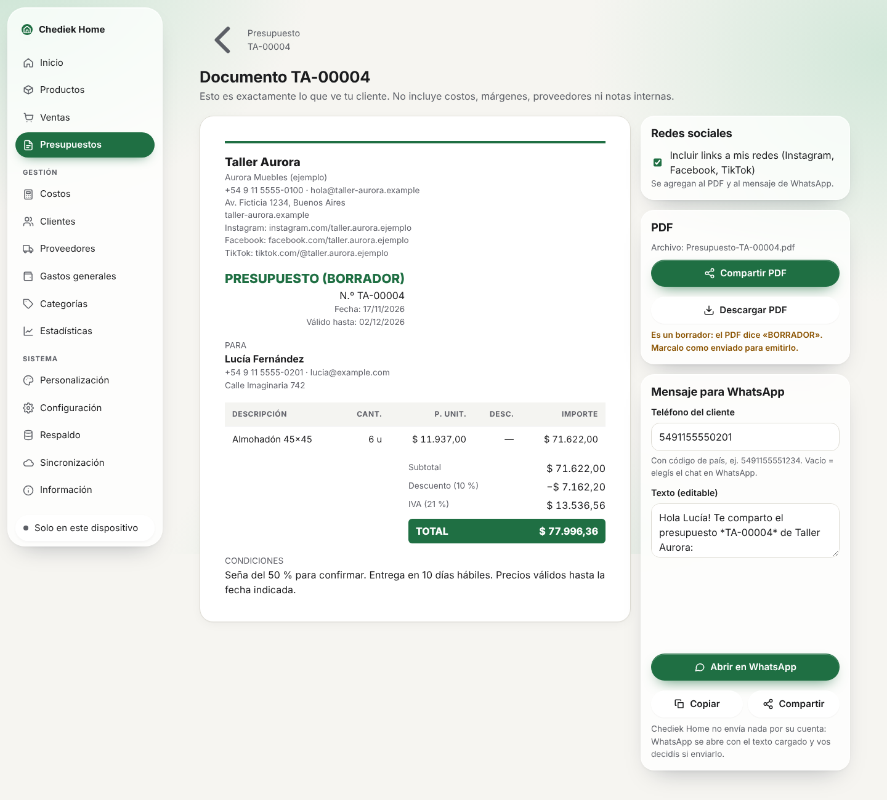 |

| Móvil | Distribución de gastos | Calculadora |
|---|---|---|
| 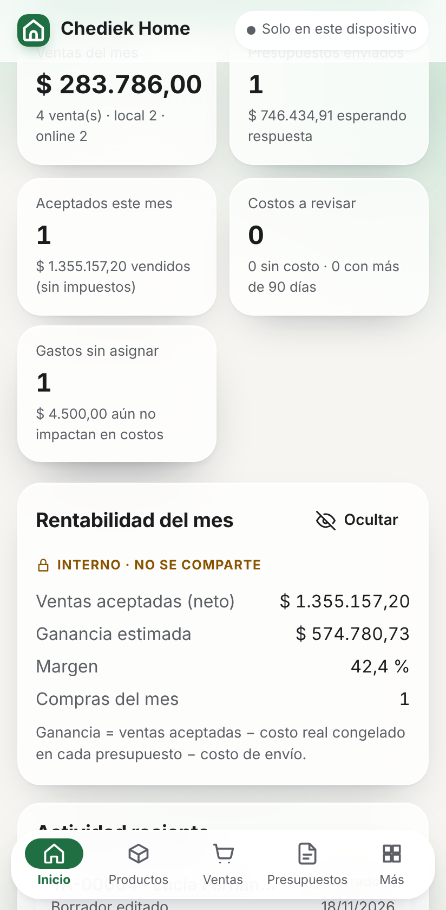 | 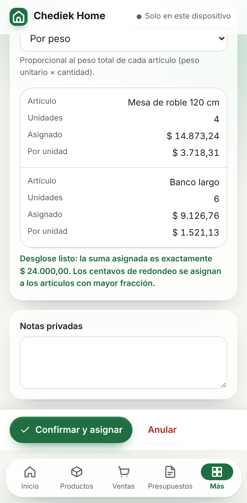 | 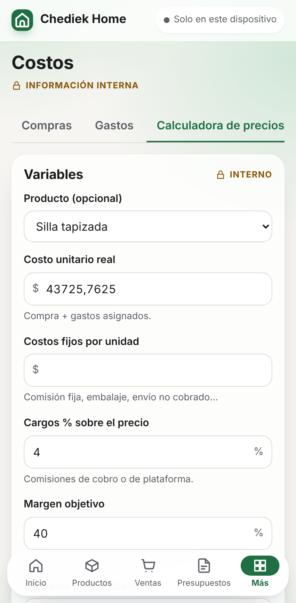 |

| Ventas | Compartir producto | (+) Pasteles |
|---|---|---|
| 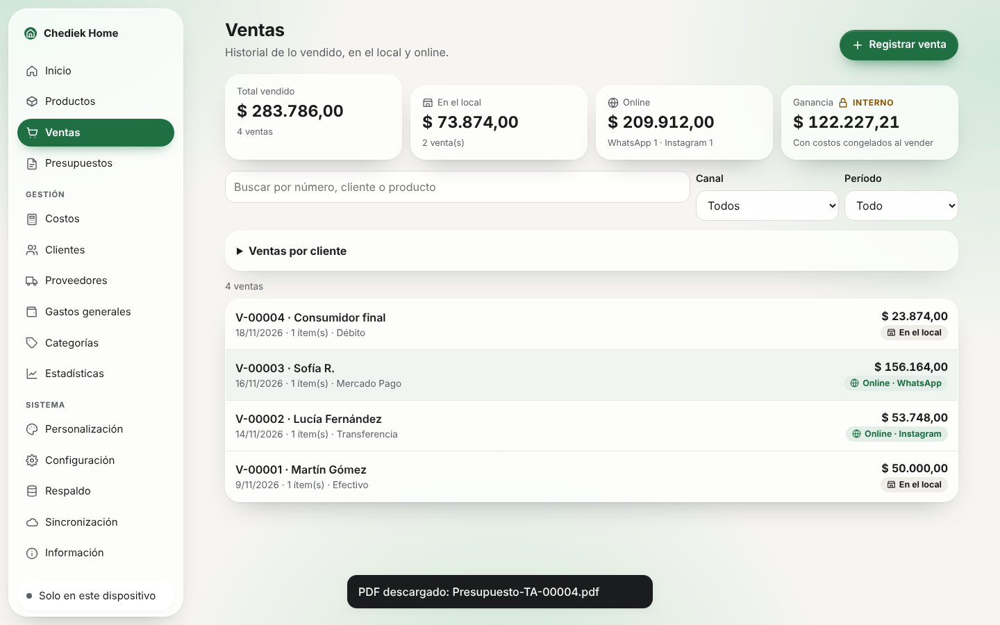 | 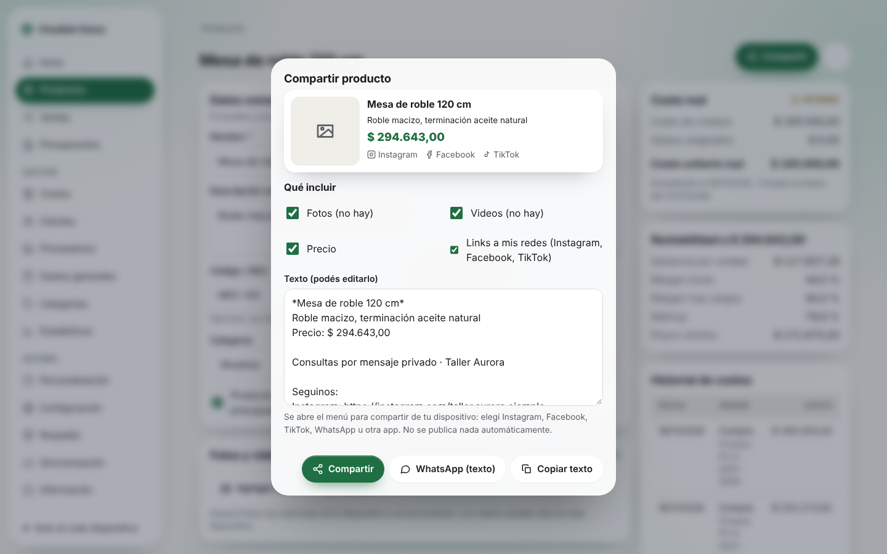 | 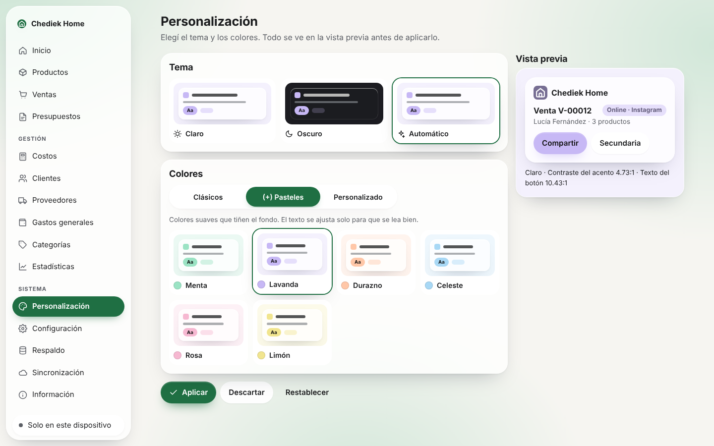 |

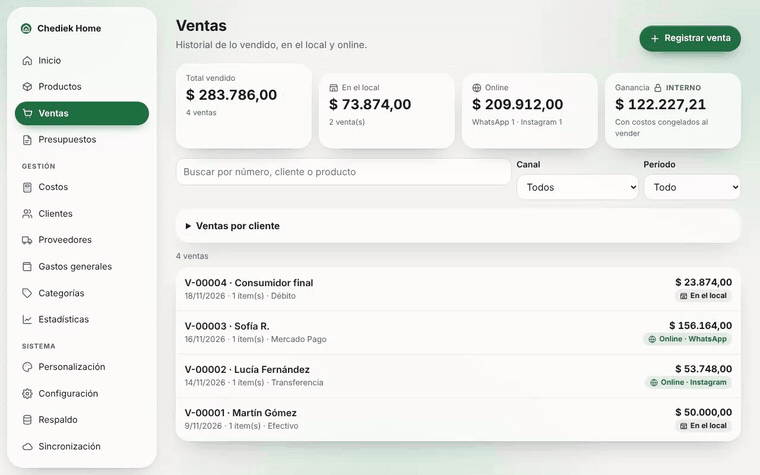

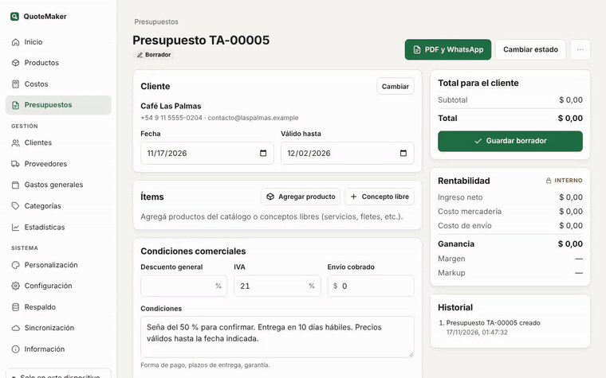

**Android** (capturas reales del emulador API 34 en CI):

| Productos | Presupuesto | Documento | Tema oscuro |
|---|---|---|---|
| 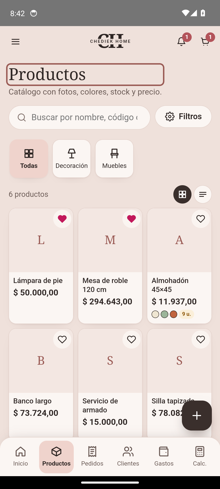 | 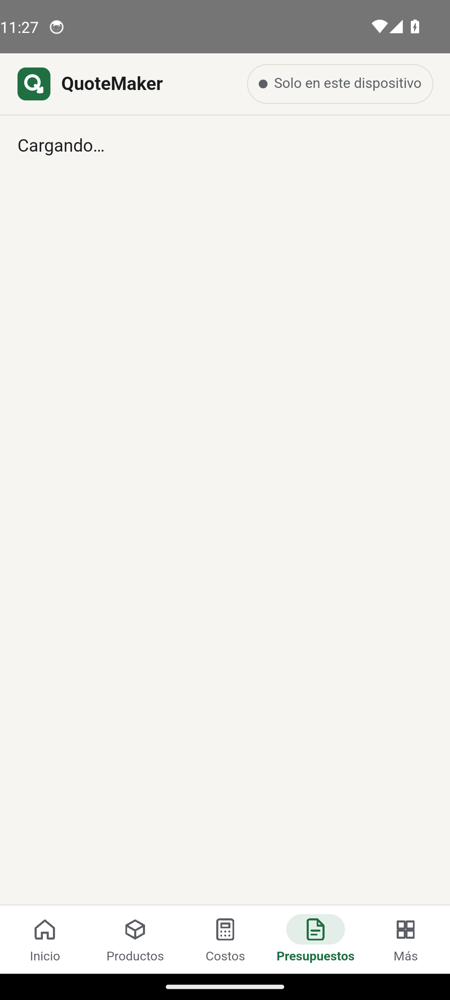 | 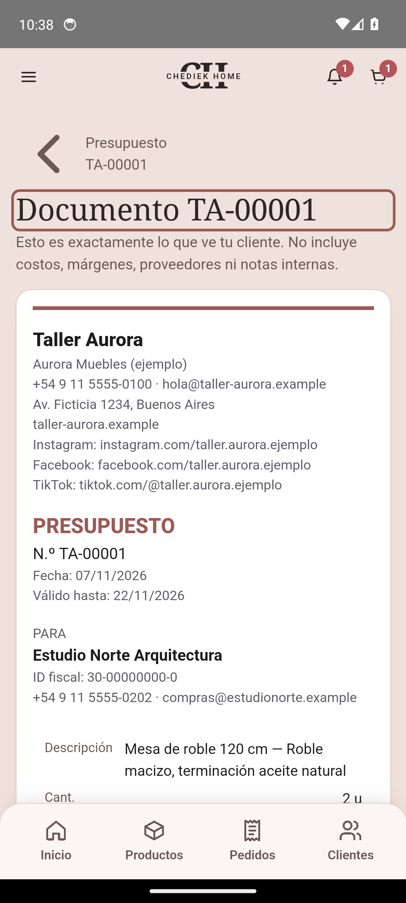 | 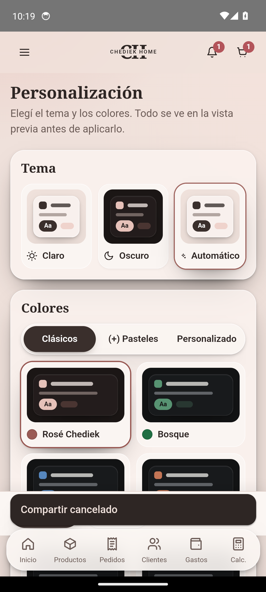 |

## Qué hace

- **Productos y proveedores**: catálogo con SKU, categorías, unidad, imagen optimizada, proveedor habitual, estado activo/archivado, historial de costos.
- **Compras**: proveedor, fecha, referencia, moneda, artículos, descuentos y cargos de factura (prorrateados por valor), comprobante adjunto.
- **Gastos asignables**: a una compra, a productos o sin asignar; distribución por unidades, valor, peso, volumen, porcentaje o importe manual, con **desglose previo** y residuos de redondeo exactos. **Nunca se cuentan dos veces.**
- **Costo real por lote** con trazabilidad e historial; anular compras o gastos recalcula sin borrar historia.
- **Gastos generales** (alquiler, internet…), únicos o recurrentes, prorrateables por unidad.
- **Calculadora**: margen vs markup (no son sinónimos), punto de equilibrio, cargos % y fijos, impuestos, descuentos, redondeos comerciales, escenarios y comparación con el precio actual.
- **Clientes privados** con notas que jamás salen en documentos.
- **Presupuestos**: ítems del catálogo o libres, descuentos por ítem y generales, impuesto, envío cobrado, validez, condiciones, historial de eventos, duplicado y **estados manuales** (Borrador, Enviado, Aceptado, Rechazado, Vencido, Cancelado). Al marcarlo como Enviado **se congela** una copia: cambios futuros de costos o precios no lo alteran.
- **PDF y WhatsApp sin filtraciones**: se generan desde un modelo público con *allowlist* explícita; pruebas automáticas extraen el texto y los metadatos del PDF y fallan ante cualquier dato interno.
- **Estadísticas**, **personalización** (claro/oscuro/automático, paletas, color propio con contraste AA garantizado), **respaldos versionados** y **sincronización opcional** con Supabase Free.

## Probalo

- **Web**: `npm ci && npm run build && npm run preview` → http://localhost:4173 (instalable como PWA). En la pantalla de inicio, «Probar con datos de ejemplo» carga datos 100 % ficticios.
- **Android**: descargá el APK de los artefactos de [CI](https://github.com/kkshiiit/QuoteMaker/actions/workflows/ci.yml) (`quotemaker-apk`) o de *Releases* cuando se publique una etiqueta `v*`. Ver [docs/INSTALLATION.md](docs/INSTALLATION.md).

## Documentación

| Para usar | Para desarrollar |
|---|---|
| [Guía de usuario](docs/USER_GUIDE.md) | [Arquitectura](docs/ARCHITECTURE.md) |
| [Instalación](docs/INSTALLATION.md) | [Base de datos y sync](docs/DATABASE.md) |
| [Preguntas frecuentes](docs/FAQ.md) | [Seguridad y privacidad](docs/SECURITY.md) |
| [Costo cero](docs/ZERO-COST.md) | [Rendimiento](docs/PERFORMANCE.md) · [Accesibilidad](docs/ACCESSIBILITY.md) |
| [Changelog](CHANGELOG.md) | [PRD](docs/PRD.md) · [Roadmap](docs/ROADMAP.md) · [CLAUDE.md](CLAUDE.md) |

## Desarrollo rápido

```bash
npm ci
npm run dev          # servidor de desarrollo
npm test             # pruebas unitarias
npm run test:integration  # PostgreSQL real: migración + RLS + sync
npm run test:e2e     # Playwright + axe (requiere npm run build)
npm run android:apk  # requiere Android SDK + JDK 21
```

## Estado y limitaciones conocidas

Lo verificado y lo pendiente está detallado en [docs/ROADMAP.md](docs/ROADMAP.md#estado-real). Lo principal:

- La sincronización cloud está implementada y probada contra **PostgreSQL real** (migración + RLS + motor de sync), pero **no contra un proyecto Supabase real**: no hay credenciales en este entorno. Sin configurarla, la app muestra «Solo en este dispositivo» y nunca finge sincronizar.
- Android usa **Capacitor** (WebView nativo), no Kotlin/Compose. Ver la justificación en [ARCHITECTURE.md](docs/ARCHITECTURE.md#por-qué-capacitor-y-no-kotlincompose).
- Pruebas e2e en CI con Chromium, Firefox, WebKit (motor de Safari) e iPhone emulado. Safari real en un dispositivo Apple no se probó.

## Licencia

[MIT](LICENSE). Sin dependencias comerciales.
