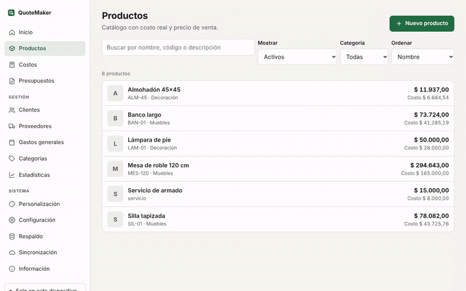
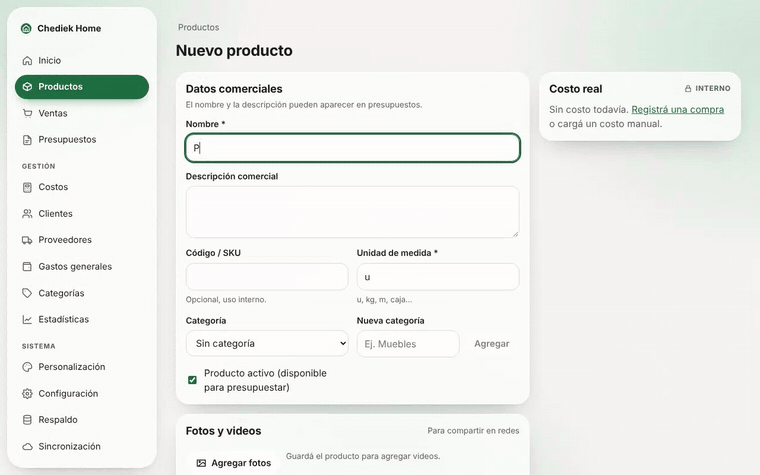
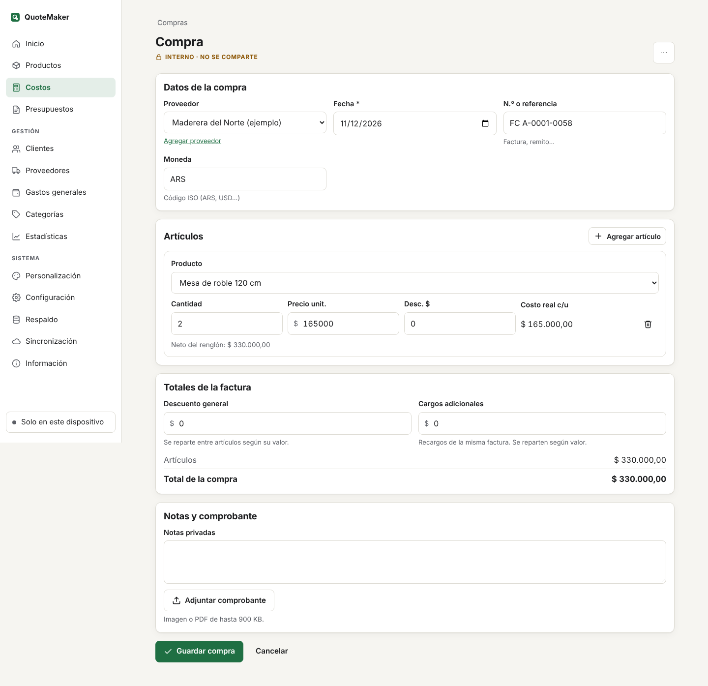
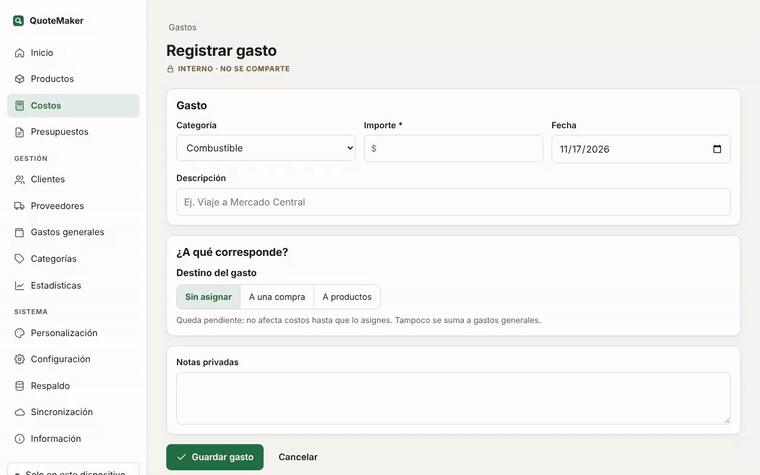
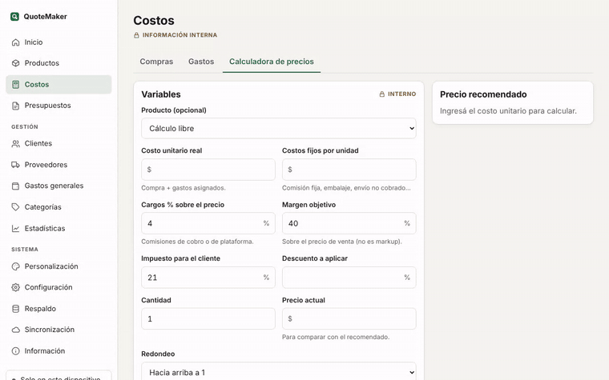
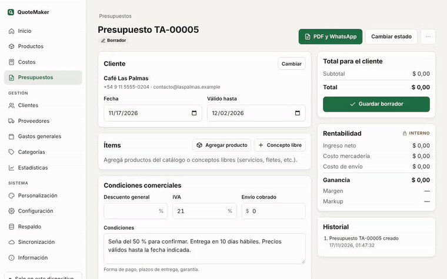
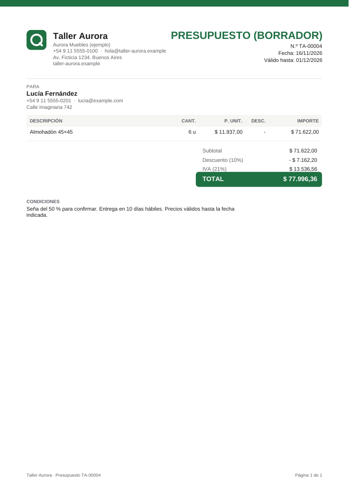
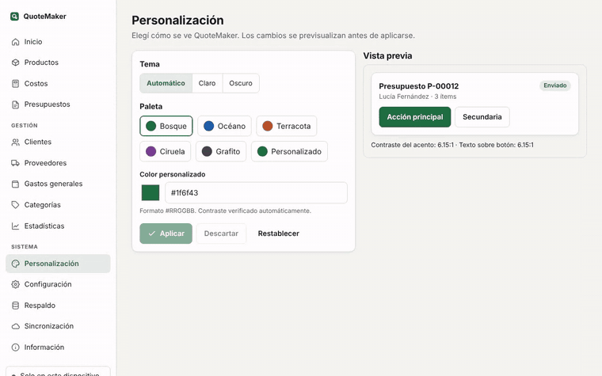

# Guía de usuario

QuoteMaker es tuya: la usás sólo vos (el titular del negocio). Tus clientes nunca entran a la app.

> ¿Primera vez? En **Inicio** tocá «Probar con datos de ejemplo» para recorrer la app con datos ficticios. Después podés empezar de cero desde **Respaldo** (importar → reemplazar) o reinstalando.

## 1. Configurá tu negocio

**Más → Configuración**

- **Identidad comercial**: nombre (obligatorio), razón social, teléfono, email, dirección, web, CUIT. Elegí qué datos mostrar en los documentos.
- **Presupuestos**: moneda, nombre y % del impuesto (0 si no discriminás), prefijo y próximo número, validez en días, condiciones por defecto.
- **Precios y costos** (interno): margen objetivo, cargos % sobre el precio (comisiones de cobro), costos fijos por unidad, redondeo, unidades vendidas por mes (para prorratear gastos generales) y a partir de cuántos días un costo se considera desactualizado.

## 2. Productos y proveedores

**Productos → Nuevo producto.** Nombre y descripción comercial (pueden salir en presupuestos), código, unidad, categoría (podés crear una en el momento), imagen (se reduce en tu teléfono), peso y volumen unitarios (para repartir gastos), costo manual (sólo si todavía no registraste compras), margen objetivo propio y precio de venta. Si dejás el precio vacío se usa el **precio sugerido**.

El panel **Costo real** muestra costo de compra + gastos asignados por unidad, la rentabilidad al precio actual (ganancia, margen bruto, margen tras cargos, markup, precio mínimo) y el **historial de costos**.

Buscá, filtrá (activos, inactivos, sin costo, costo desactualizado, archivados), filtrá por categoría y ordená. Archivar no borra: los presupuestos existentes no cambian.

**Más → Proveedores**: datos de contacto, notas privadas e historial de compras.

## 3. Compras

**Costos → Compras → Registrar compra.** Proveedor, fecha, referencia, moneda, artículos (producto, cantidad, precio unitario, descuento del renglón). Abajo: **descuento general** y **cargos adicionales** de la misma factura; se reparten entre los artículos según su valor. Al lado de cada artículo ves el **costo real por unidad** en vivo. Podés adjuntar el comprobante (imagen o PDF ≤ 900 KB).

Guardar una compra actualiza el costo de los productos y lo registra en su historial. **Anular** una compra la saca del cálculo sin borrar historia; los gastos que tenía asignados quedan marcados como «Reasignar».

## 4. Gastos (viajes, combustible, envíos…)

**Costos → Gastos → Registrar gasto.** Categoría, importe, fecha y descripción. Elegí el destino:

| Destino | Qué pasa |
|---|---|
| **Sin asignar** | Queda pendiente. No toca ningún costo y tampoco suma a gastos generales. |
| **A una compra** | Se reparte entre los artículos de esa compra. |
| **A productos** | Se reparte entre la compra más reciente de cada producto elegido. |

Criterios de reparto: **unidades**, **valor de compra**, **peso**, **volumen**, **porcentaje** o **importe** manual. Antes de confirmar ves el **desglose**: cuánto recibe cada artículo y cuánto suma por unidad. Los centavos de redondeo se asignan para que la suma sea exactamente el importe.

> **Sin doble conteo**: un gasto asignado ya forma parte del costo de los productos; las estadísticas no lo vuelven a restar.

## 5. Gastos generales

**Más → Gastos generales.** Alquiler, luz, internet, publicidad… Únicos o recurrentes (semanal, mensual, trimestral, anual), fijos o variables, con fechas y estado. Marcá «Prorratear por unidad» para que la calculadora pueda sumar su parte por unidad vendida (equivalente mensual ÷ unidades estimadas por mes).

## 6. Calculadora de precios

**Costos → Calculadora.** Elegí un producto o calculá libre.

- **Margen** = (precio − costo) ÷ precio. **Markup** = (precio − costo) ÷ costo. Un markup de 50 % es un margen de 33,3 %.
- Precio recomendado = (costo + costos fijos por unidad) ÷ (1 − cargos % − margen). Si cargos + margen llegan a 100 % te avisa que no existe precio posible.
- Precio mínimo (equilibrio), comparación con tu precio actual, escenarios de margen y redondeo comercial (siempre hacia arriba).
- «Usar como precio de…» guarda el resultado en el producto.

## 7. Clientes

**Más → Clientes.** Nombre o razón social, teléfono (con código de área para WhatsApp), email, dirección, ID fiscal y **notas privadas** (nunca salen en documentos). Te avisa si parece un duplicado. Desde el cliente podés «Presupuestar» directamente y ver su historial.

## 8. Presupuestos

**Presupuestos → Nuevo presupuesto** → elegí cliente (o «sin cliente por ahora» / crear uno).

- **Ítems**: «Agregar producto» (usa su precio y congela su costo actual) o «Concepto libre» (servicios, fletes). Editá la descripción comercial, la cantidad, el precio y el descuento.
- **Condiciones**: descuento general, impuesto, **envío cobrado** (no lleva impuesto), condiciones y notas para el cliente.
- **Datos internos** (sólo vos): costo real del envío y notas internas. El panel **Rentabilidad** muestra ingreso neto, costo, ganancia, margen y markup, y avisa si algún ítem queda bajo costo o sin costo cargado.
- «Ocultar datos internos (modo cliente)» en el menú ⋯ esconde todo lo interno si mostrás la pantalla.

### Estados (siempre manuales)

Borrador → **Enviado** → Aceptado / Rechazado / Vencido / Cancelado. Al marcarlo **Enviado** se congela una copia de los datos comerciales, precios y costos: si después cambian, este presupuesto no se modifica. Para cambiarlo, **Duplicar**. Cuando la validez vence, QuoteMaker te avisa en Inicio, pero no cambia el estado solo.

### PDF y WhatsApp

**PDF y WhatsApp** muestra exactamente lo que verá tu cliente.

- **Compartir PDF**: en Android abre el selector del sistema (WhatsApp, Gmail, Drive, Archivos…). En web usa *compartir* si el navegador lo permite o descarga el archivo.
- **Descargar / Guardar PDF**: archivo `Presupuesto-<número>.pdf` (el nombre no revela datos).
- **WhatsApp**: el mensaje se puede editar; «Abrir en WhatsApp» lo carga en el chat del cliente y **vos** tocás enviar. También podés copiarlo o compartirlo.

Cada PDF o mensaje queda registrado en el historial del presupuesto.

## 9. Estadísticas

Período (este mes, mes anterior, 90 días, año, personalizado): presupuestos emitidos, tasa de aceptación, ventas aceptadas, ganancia bruta, margen, gastos generales y sin asignar, resultado estimado, productos más vendidos, presupuestos por estado y gastos del período sin duplicar.

## 10. Personalización

Tema automático/claro/oscuro, paletas y color propio. Ves una **vista previa** antes de aplicar. Si un color no es legible, QuoteMaker ajusta el tono para cumplir contraste AA.

## 11. Respaldo

**Exportar respaldo** descarga (o en Android, abre el selector para guardar en Archivos/Drive) un JSON con todos tus datos, incluidos los internos: guardalo en un lugar privado. **Importar**: «Combinar» agrega/actualiza sin borrar; «Reemplazar todo» deja sólo lo del respaldo.

## 12. Sincronización (opcional)

Si tu instalación tiene Supabase configurado (ver [INSTALLATION.md](INSTALLATION.md#supabase-opcional)), en **Sincronización** creás tu cuenta o iniciás sesión. Los cambios se guardan primero en el dispositivo y se suben cuando hay conexión. El indicador muestra: solo en este dispositivo, pendientes, sincronizado, error o conflictos. Si editaste lo mismo en dos dispositivos, elegís qué versión conservar; nada se descarta solo.

## Copias externas vs. registros

Un PDF compartido o guardado en Drive/Archivos es una **copia externa**. Borrarla no borra el presupuesto ni su registro en la app, y borrar algo en la app no borra las copias que ya compartiste.
