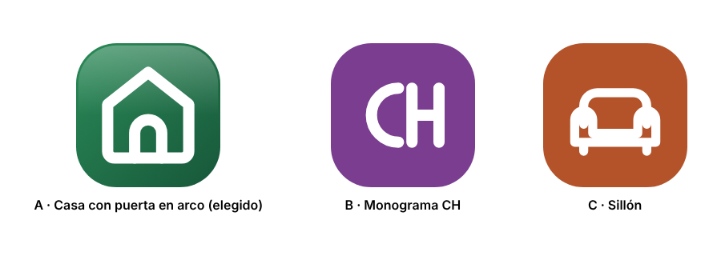

# Identidad visual de Chediek Home

## Conceptos explorados

| | A · Casa con puerta en arco (elegido) | B · Monograma CH | C · Sillón |
|---|---|---|---|
| Idea | Una casa de líneas suaves con puerta en arco: el hogar y la tienda | Iniciales C y H | Un sillón: muebles y deco |
| Legibilidad a 16 px | Alta: contorno grueso y simple | Media | Media: detalles finos |
| Memorabilidad | Alta: se asocia directo a «Home» | Baja: monogramas genéricos | Media |
| Escalabilidad (favicon → splash) | Excelente | Buena | Regular |
| Ícono adaptativo de Android | Encaja en la zona segura | Bien | Recorta las patas |

**Elegido: A.** Es el más legible en tamaños chicos y comunica el nombre sin depender de letras. Insignia con degradé verde y brillo superior (estilo «Spatial»); en la app la insignia toma el color del tema elegido.

## Archivos

| Archivo | Uso |
|---|---|
| `logo-mark.svg` | Marca principal (degradé verde #2A8A57→#17573A, casa en trazo blanco) |
| `logo-mark-dark.svg` | Sobre fondos oscuros |
| `logo-mark-mono.svg` | Monocromo (impresión, sellos) |
| `logo-horizontal-light.svg` / `-dark.svg` / `-mono.svg` | Marca + logotipo horizontal |
| `icon-maskable.svg` | Ícono PWA *maskable* (zona segura 60 %) |
| `png/logo-mark-1024.png`, `png/logo-horizontal-*.png` | Versiones rasterizadas |
| `png/splash-2732.png`, `png/splash-dark-2732.png` | Splash claro/oscuro |
| `../../public/favicon.svg`, `favicon.ico`, `apple-touch-icon.png`, `icons/*` | Web/PWA |
| `../../android/app/src/main/res/mipmap-*`, `drawable*/splash.png` | Android (legacy, round, foreground adaptativo, splash) |

El logotipo usa la tipografía del sistema (sin fuentes externas ni licencias). Todos los recursos son SVG propios rasterizados con `scripts/render-brand.mjs` y `scripts/render-android.mjs` (Chromium local); no se usaron bancos de imágenes ni generación paga.

## Paleta

Bosque #1F6F43 (principal), Océano #1D5FA8, Terracota #B4532A, Ciruela #7A3D8F, Grafito #3F4752. Fondo claro #F6F5F1, oscuro #121314. Los acentos se ajustan automáticamente para contraste AA.
